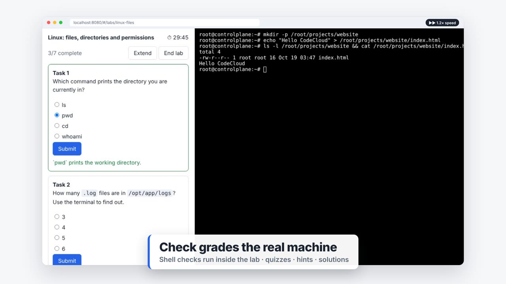

# CodeCloud

An open-source, self-hostable **hands-on DevOps lab platform**, in the style of KodeKloud:
courses with short lessons, auto-graded labs that give every learner a real Linux machine,
Docker engine or Kubernetes cluster in the browser, and free-form playgrounds.

[](docs/assets/codecloud-demo.mp4)

▶ **[Watch the 75-second tour](docs/assets/codecloud-demo.mp4)**. It covers the catalog, learning paths,
real Linux, Docker and Kubernetes labs, auto-grading, playgrounds, edX in and out, and the CI that keeps
it all working. Every shot is the real product; the video is rebuilt by a
[GitHub workflow](.github/workflows/video.yml) using [/brag](https://github.com/latent-spaces/brag)
(see [video/](video/README.md)).

* **Real environments, not simulators.** Each lab session is a disposable container:
  Ubuntu, Docker-in-Docker, or a single-node Kubernetes cluster (k3s).
* **Browser terminal.** xterm.js over a WebSocket to a TTY in the learner's container.
* **Auto-grading.** Multiple-choice questions are checked server-side. Practical tasks run a
  shell `check` script inside the environment, where exit code 0 is a pass.
* **Timers, extensions, cleanup.** Labs expire and their containers are reaped automatically.
* **Content as code.** Courses are Markdown and labs are YAML, validated and smoke-tested from the CLI.

How the original works, and how this was reverse engineered and mapped to open-source parts:
[docs/how-kodekloud-works.md](docs/how-kodekloud-works.md).
Catalog, edX and CI automation: [docs/catalog.md](docs/catalog.md).
Internals: [docs/architecture.md](docs/architecture.md).
Library choices: [docs/foss-choices.md](docs/foss-choices.md).

## Quick start

Requirements: Node.js 22+ and a Docker Engine the platform can reach.

```bash
npm install
export CODECLOUD_SESSION_SECRET=$(openssl rand -hex 32)
npm start                      # http://localhost:8080
```

Or with Docker Compose:

```bash
CODECLOUD_SESSION_SECRET=$(openssl rand -hex 32) docker compose up -d --build
```

Create an account in the UI, open the **Catalog**, **Labs** or **Playgrounds**, and start one.
The first start of each lab pulls its image, so it takes longer.

> The platform controls Docker, and the Docker and Kubernetes labs run privileged containers.
> Run it on a dedicated host and read [Isolation](docs/architecture.md#isolation) before
> exposing it to untrusted users.

## Course catalog

**20 courses, 21 auto-graded labs, 3 playgrounds and 4 learning paths**, covering DevOps
foundations, Linux, networking, Git, Bash, Python, Docker and Compose, Kubernetes (workloads,
configuration, storage, networking, RBAC), Helm, OpenTofu, Ansible, CI/CD with GitHub Actions,
Prometheus, NGINX, PostgreSQL and AWS (emulated with Moto). Courses from **edX** appear alongside
them, and every course can be exported to **Open edX**. See [docs/catalog.md](docs/catalog.md).

Heavy and scheduled work runs in **GitHub Actions**: nightly smoke tests of every lab, weekly
lab-image builds pushed to GHCR, a weekly edX catalog sync that opens a PR, and Open edX exports
on every content change.

## Writing labs

```bash
npm run validate-content                       # schema-check all courses, labs and the catalog
node src/cli.js test-lab linux-files --solve   # boot the lab, run every solution, verify every check
```

The lab format is documented in [docs/architecture.md](docs/architecture.md#authoring-labs).

## edX and Open edX

```bash
node scripts/sync-edx.js                                          # refresh edX courses in the catalog
CODECLOUD_PUBLIC_URL=https://labs.example.org node scripts/export-olx.js   # Open edX course archives
```

## Launch video

```bash
BASE_URL=http://localhost:8080 npm run video   # needs a running server, Docker, Playwright Chromium and FFmpeg
```

Output goes to `brag-output/`. Run the *Launch video* workflow to re-render it in CI and open a PR
that updates the video above.

## Development

```bash
npm test               # unit + API tests (fake runtime, no Docker needed)
npm run test:docker    # integration tests against a real Docker Engine
npm run dev            # restart on change
```

## License

[AGPL-3.0-or-later](LICENSE). This is an independent implementation and is not affiliated with KodeKloud.
