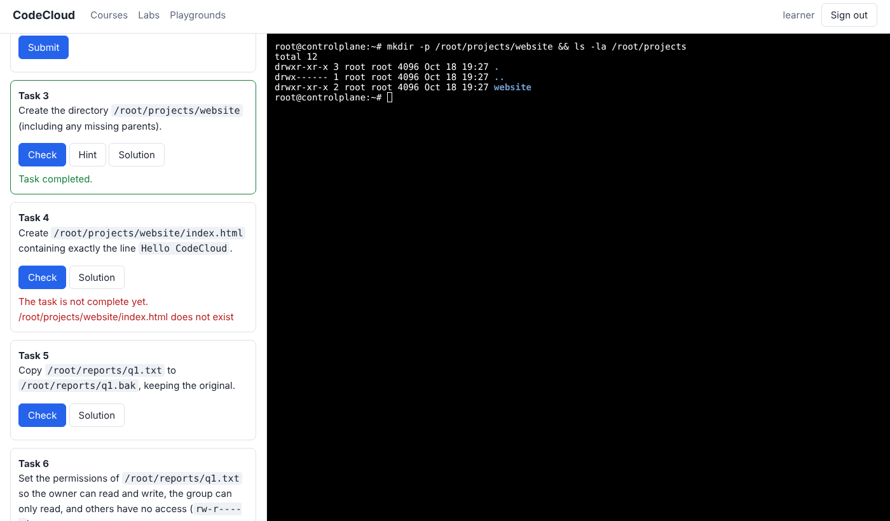

# CodeCloud

An open-source, self-hostable **hands-on DevOps lab platform**, in the style of KodeKloud:
courses with short lessons, auto-graded labs that give every learner a real Linux machine,
Docker engine or Kubernetes cluster in the browser, and free-form playgrounds.



* **Real environments, not simulators.** Each lab session is a disposable container:
  Ubuntu, Docker-in-Docker, or a single-node Kubernetes cluster (k3s).
* **Browser terminal.** xterm.js over a WebSocket to a TTY in the learner's container.
* **Auto-grading.** Multiple-choice questions are checked server-side. Practical tasks run a
  shell `check` script inside the environment, where exit code 0 is a pass.
* **Timers, extensions, cleanup.** Labs expire and their containers are reaped automatically.
* **Content as code.** Courses are Markdown and labs are YAML, validated and smoke-tested from the CLI.

How the original works, and how this was reverse engineered and mapped to open-source parts:
[docs/how-kodekloud-works.md](docs/how-kodekloud-works.md).
Internals: [docs/architecture.md](docs/architecture.md).
Library choices: [docs/foss-choices.md](docs/foss-choices.md).

## Quick start

Requirements: Node.js 22+ and a Docker Engine the platform can reach.

```bash
npm install
export CODECLOUD_SESSION_SECRET=$(openssl rand -hex 32)
npm start                      # http://localhost:8080
```

Or with Docker Compose:

```bash
CODECLOUD_SESSION_SECRET=$(openssl rand -hex 32) docker compose up -d --build
```

Create an account in the UI, open **Courses**, **Labs** or **Playgrounds**, and start one.
The first start of each lab pulls its image, so it takes longer.

> The platform controls Docker, and the Docker and Kubernetes labs run privileged containers.
> Run it on a dedicated host and read [Isolation](docs/architecture.md#isolation) before
> exposing it to untrusted users.

## Included content

| Course | Labs |
|---|---|
| Linux Foundations | `linux-files` (files, permissions, users), `linux-processes` (processes, pipes) |
| Containers and Kubernetes | `docker-basics` (Docker-in-Docker), `kubernetes-pods` (k3s) |
| Playgrounds | `playground-ubuntu` (built from a Dockerfile), `playground-kubernetes` |

## Writing labs

```bash
npm run validate-content                       # schema-check all courses and labs
node src/cli.js test-lab linux-files --solve   # boot the lab, run every solution, verify every check
```

The lab format is documented in [docs/architecture.md](docs/architecture.md#authoring-labs).

## Development

```bash
npm test               # unit + API tests (fake runtime, no Docker needed)
npm run test:docker    # integration tests against a real Docker Engine
npm run dev            # restart on change
```

## License

[AGPL-3.0-or-later](LICENSE). This is an independent implementation and is not affiliated with KodeKloud.
